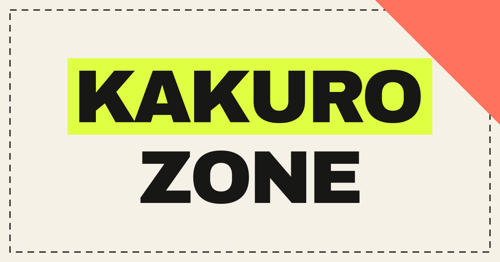

[](https://app.netlify.com/projects/kakurozone/deploys)

A kakuro puzzle website for daily fun, with printable puzzle packs.

[Play now!](https://kakurozone.netlify.app/)

After solving, Share includes your solve time, hint count, and puzzle link.
Time counts only while the puzzle page is visible and is saved across visits.
Puzzles completed before time tracking was available still share just the link.

## How to run locally

With Node.js 22.12+ installed:

```sh
git clone https://github.com/cassidoo/kakurozone.git
cd kakurozone
npm ci
npm run dev
```

Open [localhost:5173](http://localhost:5173).
